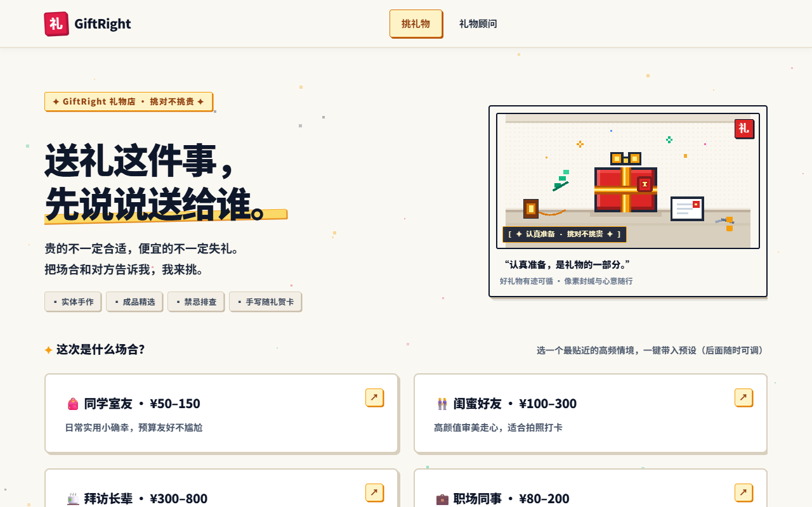
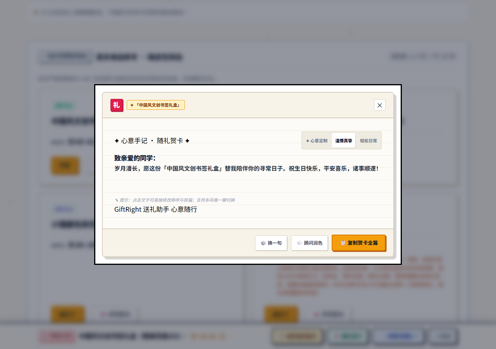
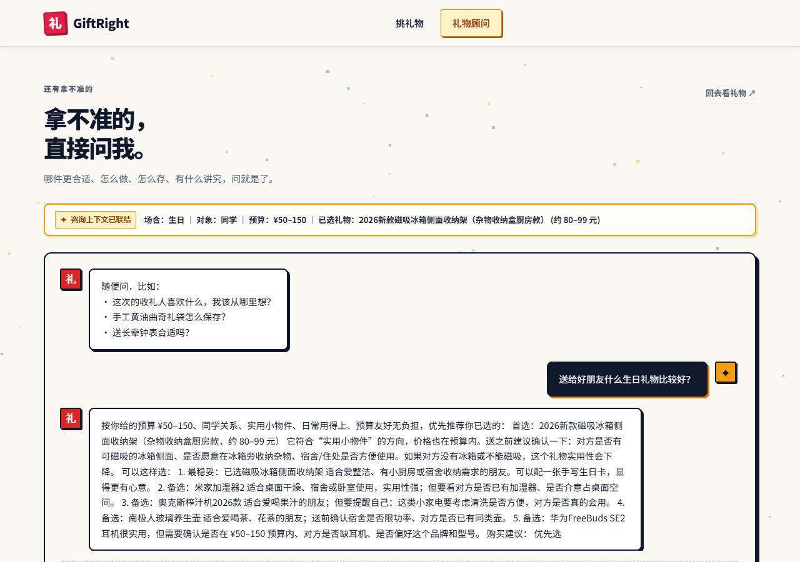

# GiftRight 智能送礼决策系统 (AI Agent & 推荐工作流)

> 基于 **“确定性规则护栏 + Dify AI 深度推荐工作流”** 双擎驱动的智能送礼决策与顾问系统。

---

## 🌟 项目亮点

1. **双擎混合决策架构**：
   * 前置 Python 确定性规则引擎，下沉 100+ 条地域风俗与禁忌规则，硬性约束预算范围，实现**禁忌规避率 100%**。
   * 后置 Dify 13 节点复合工作流，实现意图识别、多路知识库语义检索、LLM 心意打分与重排。
2. **两阶段异步响应（感知时延 0.05s）**：
   * 提交选品后，50ms 内率先下发本地精选候选集，消除白屏等待；
   * 后台异步并发请求 Dify AI 链路，完成后热更新推荐结果。
3. **真实商品与手作库沉淀**：
   * 接入 4,180 件真实在售品与工艺手作库，杜绝大模型数字幻觉与虚构报价。
4. **全链路体验闭环**：
   * **随礼手写贺卡生成器**：支持 3 种情绪风格切换、随机洗牌换句与自由编辑。
   * **流式 SSE 智能顾问**：页面常驻 Action Dock，随时解答搭配与赠礼礼仪。
   * **跨视图无损导航状态机**：多视图自由切换，页面输入与状态不丢失。

---

## 📸 界面预览

<table>
  <tr>
    <td width="50%" align="center"><b>场景引导与工坊主页</b></td>
    <td width="50%" align="center"><b>决策结果与随礼贺卡</b></td>
  </tr>
  <tr>
    <td></td>
    <td></td>
  </tr>
  <tr>
    <td width="50%" align="center"><b>偏好录入弹窗</b></td>
    <td width="50%" align="center"><b>流式 SSE 顾问咨询</b></td>
  </tr>
  <tr>
    <td></td>
    <td></td>
  </tr>
</table>

---

## 📂 仓库结构

```text
GiftRight_GitHub/
├── assets/                     # README 预览插图 (工坊首页、贺卡、顾问、向导)
├── app.py                      # 后端核心网关（纯 Python 标准库，异步任务队列与 SSE 透传）
├── engine.py                   # 确定性规则引擎（禁忌库排查、预算硬锁、多样性加权）
├── requirements.txt            # 开发与测试依赖
├── .env.example                # 环境变量配置模板
├── 一键启动GiftRight.bat         # Windows 本地一键启动脚本
├── deploy.sh                   # Linux / 云服务器生产部署脚本
├── web/                        # 前端单页应用
│   ├── index.html              # 内联矢量手绘插画、语义化布局
│   ├── styles.css              # 像素复古与暖色手作视觉规范
│   └── app.js                  # 双 Canvas 粒子特效、状态机、贺卡生成器
├── dify/                       # Dify 工作流资产
│   ├── GiftRight.ifpkg         # Dify 一键导入包
│   ├── dify_workflow_graph.json# 13 节点拓扑契约图
│   └── rule_node_final.py      # Dify 沙箱代码节点离线源码
├── data/                       # 知识库与数据资产
│   ├── products.json           # 核心在售品库
│   ├── diy_gifts.json          # 自制手作礼物库
│   ├── real_catalog/           # 真实商品分面明细
│   └── real_rules/             # 节日与民俗禁忌规则表
├── eval/                       # 评测体系
│   ├── run_eval.py             # 离线自动化评测脚本
│   ├── scenarios.json          # 12 类场景基准集 (174 样本)
│   └── experiment_results.json # 评测指标与耗时记录
└── docs/                       # 详细工程架构文档
    ├── 01_完整技术文档.md
    ├── 02_Dify工作流复刻指南.md
    ├── 03_提示词全文.md
    ├── 04_数据结构与部署.md
    └── 05_设计决策与排错.md
```

---

## 🚀 快速上手

### 1. 本地启动 (Windows / macOS / Linux)

项目后端使用 Python 标准库构建，无需安装繁杂的三方库即可启动核心服务：

```bash
# 1. 复制环境变量模板
cp .env.example .env

# 2. 填写 Dify API 凭证 (可选，若不配置将自动运行在确定性规则离线模式)
# 编辑 .env 中的 DIFY_API_KEY 与 DIFY_CHAT_API_KEY

# 3. 运行服务
python app.py
```

* Windows 用户可直接双击运行根目录下的 `一键启动GiftRight.bat`。
* 启动完成后，在浏览器中打开 `http://127.0.0.1:8000` 即可体验。

### 2. 离线评测与基准测试

```bash
python eval/run_eval.py
```

---

## 📊 架构设计与性能表现

```text
[用户输入] ───► [本地确定性规则引擎 (engine.py)] ───► 首屏 50ms 候选秒出 (0.05s)
                    │
                    ▼ (异步并发)
         [Dify 13节点工作流]
                    │
   [意图识别] ──► [多库 RAG] ──► [心意评分] ──► [结构校验]
                    │
                    ▼
         [后台平滑热更新决策结果]
```

* **首屏感知延迟**：由原本的 40s 缩减至 **0.05s**。
* **民俗禁忌规避率**：硬规则前置过滤，达到 **100%**。
* **Token 消耗**：优化后单次会话推理 Token 削减约 **35%**。

---

## 📄 开源许可

本项目采用 [MIT License](LICENSE) 授权。
